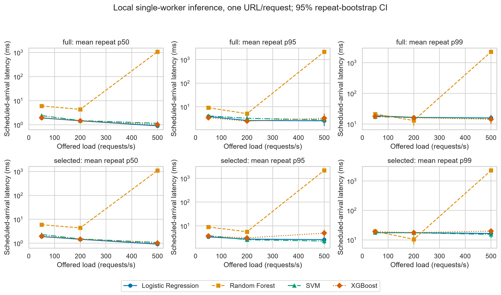
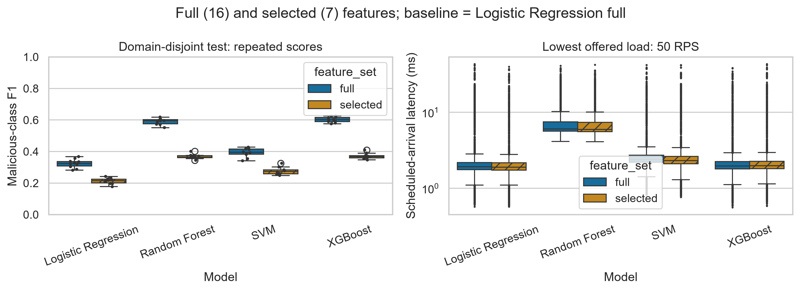

# Comparative Evaluation of Machine Learning Models for URL Classification

Authors: Zhanna Azatkyzy, Dariyana Gabdylshukir

The broader research topic is phishing detection. This dataset supports malicious-versus-benign URL classification only.

## Research questions

- RQ1: How does model choice affect malicious-class F1?
- RQ2a: How does using seven instead of 16 lexical features affect F1?
- RQ2b: How does the feature set affect latency at each scheduled request rate?
- RQ3: What F1-latency trade-offs occur under the tested loads?

Baseline: Logistic Regression with all 16 features. Results are descriptive.

## Completed experiment

The completed run uses 19,979 URLs after excluding 21 rows whose domains could not be validated, from the original 20,000-URL sample. There are 3,211 malicious and 16,768 benign URLs, grouped into 10,858 domains. Domain validation is a selection rule and may affect representativeness.

Four models and two feature sets are evaluated on ten GroupShuffleSplit partitions (seeds 42-51). Each partition holds out 30% of domain groups; the test URL fraction varies from 27.27% to 33.99%. Splits are not stratified. No registrable domain occurs in both training and test within a repeat. Private public-suffix rules are included using the offline snapshot bundled with tldextract 5.4.0. The same split is used across configurations. The seven features are predefined, without test-set feature selection.

Latency uses one URL per request at scheduled arrival rates of 50, 200 and 500 requests/s. Each configuration and rate has 20 warm-up and 1,000 evaluation calls per repeat: 240,000 evaluation calls in total. A single local worker extracts features and predicts labels; numerical libraries are limited to one thread. This is not an HTTP or network service benchmark. Model training and warm-up are excluded.

Latency is completion time minus intended arrival time, including scheduler lag, queueing and service time. Recorded service time includes feature extraction and prediction. Request submission rate and successful completion throughput are reported separately. The finite trials drain their queues after arrivals stop; they do not establish indefinitely sustainable capacity.

Quality summaries report mean and sample SD across repeats. Latency p50, p95 and p99 are computed within each repeat, then averaged across repeats. A reported mean p99 is not a pooled-request p99. Percentile bootstrap intervals resample the ten repeat-level statistics, using 2,000 resamples and seed 42. Repeats share observations: intervals describe variability conditional on this dataset and protocol, without a formal significance test.

Guardrails require mean malicious recall at least 0.80, worst repeat-level p99 at most 100 ms at the specified arrival rate, and recorded operational error rate zero. Operational errors are execution failures, not classification errors.

Run identifier: `20261105T122952Z_dbea27e6`. Losslessly compressed raw records (`raw.jsonl.gz`), cleaned dataset, split indices, configuration, source hashes and environment are in `data/review_runs/20261105T122952Z_dbea27e6/`.

## Results and discussion

| Model | Features | F1 mean ± SD | F1 95% CI | Mean recall |
|---|---|---|---|---|
| Logistic Regression | full | 0.324 ± 0.028 | [0.308, 0.340] | 0.200 |
| Logistic Regression | selected | 0.214 ± 0.019 | [0.202, 0.225] | 0.122 |
| Random Forest | full | 0.590 ± 0.020 | [0.578, 0.601] | 0.555 |
| Random Forest | selected | 0.367 ± 0.015 | [0.359, 0.377] | 0.296 |
| SVM | full | 0.393 ± 0.029 | [0.376, 0.410] | 0.255 |
| SVM | selected | 0.276 ± 0.024 | [0.264, 0.292] | 0.165 |
| XGBoost | full | 0.602 ± 0.018 | [0.592, 0.613] | 0.512 |
| XGBoost | selected | 0.370 ± 0.018 | [0.360, 0.381] | 0.254 |

XGBoost with 16 features has the highest observed mean F1 (0.602), followed by Random Forest (0.590), SVM (0.393), and the Logistic Regression baseline (0.324). Seven features lower mean F1 for every model. The timed code calculates all 16 lexical features before selecting seven, so it does not isolate potential savings from an optimized selected-feature extractor. These comparisons are descriptive; no statistical rejection of a null hypothesis is claimed.

Random Forest has the highest mean recall (0.555), below the predefined 0.80 threshold. No configuration passes all guardrails. All 240,000 evaluation requests complete without recorded operational errors. Random Forest fails the latency guardrail at 500 requests/s: mean repeat-level p99 is about 2.27-2.28 seconds and worst repeat-level p99 is 2.31-2.42 seconds. Queue measurements show backlog in these finite trials. All configurations pass the latency threshold at 50 and 200 requests/s; the other three models also pass at 500 requests/s.

XGBoost with all features offers a useful observed F1-latency trade-off, but does not meet the recall requirement. The experiment compares fixed model settings; it does not tune decision thresholds or class weights. Any future tuning must use training/validation data and a fresh held-out evaluation, rather than optimizing these test results.

The labels distinguish malicious and benign URLs, without a separate phishing category. Domain-disjoint splitting removes domain overlap within each split, but does not guarantee independence of campaigns, URL templates or repeated splits. Timing depends on the recorded Windows environment, operating-system scheduling and local worker design. Lower median latency at a higher arrival rate is observed for some models and should not be interpreted as a general causal speedup.



Figure 1. Mean repeat-level p50/p95/p99 latency by scheduled arrival rate, with 95% bootstrap intervals. Latency axis is logarithmic. [PDF](reports/figures/fig1_latency_vs_rps.pdf).



Figure 2. F1 across repeats and request latency at 50 requests/s. [PDF](reports/figures/fig2_distributions.pdf).

## Reproduce

Use Python 3.11.9. The recorded environment is Windows build 22631, with 12 logical CPUs; numerical libraries use one thread. It is not a one-CPU hardware claim. Exact installed versions are captured in the run's `analysis-environment.txt` and metadata. A convenience lock is supplied in `requirements-review-lock.txt`; availability on other platforms may differ.

```powershell
.\.venv\Scripts\python.exe -m pip install -r requirements-review-lock.txt
.\.venv\Scripts\python.exe -m unittest discover -s tests -v
powershell -ExecutionPolicy Bypass -File .\RUN_REVIEW.ps1
# Full new experiment, only if needed:
powershell -ExecutionPolicy Bypass -File .\RUN_REVIEW.ps1 -Full
```

The short run is a smoke check and is not research evidence. Every experiment writes a new folder. To recompute statistics from the completed raw log without repeating model training or timing:

```powershell
.\.venv\Scripts\python.exe src/analyze_review.py --run-dir data/review_runs/20261105T122952Z_dbea27e6
```

`notebooks/01_data_analysis.ipynb` validates the saved splits and displays the current tables and figures. `data/processed/` and `reports/figures/` contain copies for convenient viewing. Raw measurements remain in the run folder as `raw.jsonl.gz`; the analyzer reads compressed or plain logs. The notebook reads published tables from `data/processed/` and figures from `reports/figures/`. Generated copies inside the run folder are ignored. The original `run_experiment.py` batch-size experiment and Task 2 Docker smoke test are historical workflows and do not reproduce these RPS results. Previous batch-size results and the superseded report are preserved under `archive/task3_batch/`. The final report awaits revision.

## Files

| File | Purpose |
|---|---|
| `src/run_review.py` | Domain splits, training, scheduled single-URL requests and raw records |
| `src/review_common.py` | Dataset validation, domain grouping and lexical features |
| `src/review_models.py` | Fixed settings for all four classifiers |
| `src/analyze_review.py` | Metrics, intervals, guardrails and figures |
| `configs/review.yaml` | Full protocol |
| `docs/domain_model.md` | Labels, features, objectives and metric definitions |
| `docs/methodology.md` | Current protocol and historical Task 2 plan |

## Author contributions


| Author | Task 2 | Task 3 |
|---|---|---|
| Dariyana Gabdylshukir | methodology, Docker pipeline, smoke test | notebook, domain model, README results, report |
| Zhanna Azatkyzy | repository upload | dataset and experiment runs, data processing, figures, Git and release |


The table above records the original division of work. Dariyana additionally ran the revised domain-disjoint RPS experiment and reviewed the documentation and notebook. Git history records who committed each change; uploading a file alone does not establish its original authorship. Report and release completion remain pending.

## License

MIT License, see [LICENSE](LICENSE).

## Historical workflow

`archive/task3_batch/` preserves the previous batch-size outputs and superseded report. Its `src/` scripts and configuration reproduce the historical workflow, not the current RPS analysis. Task 2's `src/benchmark.py`, `configs/config.yaml`, Dockerfile and CI remain in their original locations. Current research scripts use the `review` names. The baseline dataset preparation script remains `src/prepare_dataset.py`.
