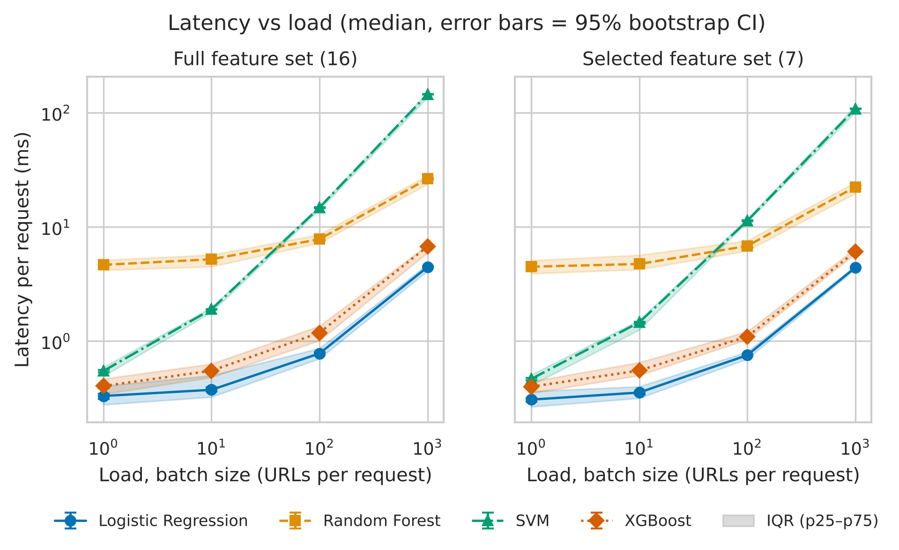
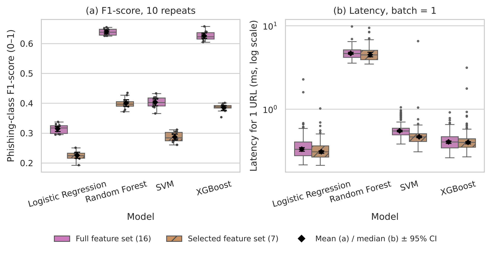

# Comparative Evaluation of Machine Learning Models for Phishing URL Detection

Authors: Zhanna Azatkyzy, Dariyana Gabdylshukir

We compare four ML models (Logistic Regression, Random Forest, SVM, XGBoost) for detecting phishing URLs using 16 lexical features of the URL. We measure detection quality (F1-score for the phishing class) and inference time.

## Research questions

- **RQ1:** How does the algorithm affect the F1-score?
- **RQ2:** How does feature selection (16 → 7 features) affect the results?
  - RQ2a: H0: F1 does not differ between the full and selected feature sets; H1: F1 differs.
  - RQ2b: H0: inference time does not differ between the feature sets; H1: inference time differs.
- **RQ3:** What is the trade-off between F1-score and inference time?

Baseline: Logistic Regression with all 16 features.

## Repository structure

```
data/raw/test_run.jsonl            raw benchmark log (warm-up and evaluation calls)
data/processed/metrics_summary.csv aggregated metrics
data/sample/                       URL samples (urls_research_sample.csv - 20 000 URLs)
docs/domain_model.md               domain model: loss functions, metrics, notation
docs/methodology.md                methodology (Task 2)
notebooks/01_data_analysis.ipynb   data analysis notebook
reports/figures/                   figures (pdf + png)
src/prepare_dataset.py             dataset download and sampling
src/run_experiment.py              experiment, writes the raw log
src/process_data.py                data processing and statistics
src/visualize.py                   figures
src/benchmark.py                   Task 2 smoke test
configs/experiment.yaml            Task 3 experiment settings
```

## How the results are produced

```
data/sample/urls_research_sample.csv      (src/prepare_dataset.py)
        |  src/run_experiment.py
        v
data/raw/test_run.jsonl                   raw log, warm-up + eval calls
        |  src/process_data.py            remove warm-up, metrics, median/p95/p99, bootstrap CI, guardrails
        v
data/processed/metrics_summary.csv        table in "Results & Discussion"
        |  src/visualize.py
        v
reports/figures/fig1..., fig2...          figures (pdf + png 300 dpi)
```

The notebook `notebooks/01_data_analysis.ipynb` runs the same steps with explanations and saved outputs.

| Requirement | Where |
|---|---|
| Raw data with warm-up and evaluation runs | `data/raw/test_run.jsonl` (field `phase`) |
| Cleaned and aggregated metrics | `data/processed/metrics_summary.csv` |
| Warm-up filtering, median, p95, p99, 95% CI, guardrails | `src/process_data.py`, notebook sections 1–2 |
| Figures (pdf + png 300 dpi) | `reports/figures/`, made by `src/visualize.py`, notebook section 3 |
| Domain model (loss function, metrics, notation) | `docs/domain_model.md` |
| Fixed random seed | seed 42 in the notebook and in `src/process_data.py`, split seeds 42–51 |

## How to run

```bash
pip install -r requirements-analysis.txt
python src/prepare_dataset.py   # download data and make a sample of 20 000 URLs
python src/run_experiment.py    # run the experiment (~4 min)
python src/process_data.py      # statistics -> data/processed/metrics_summary.csv
python src/visualize.py         # figures -> reports/figures/
```

The raw log is already in the repository, so the last two steps and the notebook can be run without running the experiment again. The Task 2 Docker smoke test works as before (`docker build -t phishing-url-benchmark .`).

## Experiment setup

- Dataset: public labelled URL dataset ([faizann24/Using-machine-learning-to-detect-malicious-URLs](https://github.com/faizann24/Using-machine-learning-to-detect-malicious-URLs)), duplicates removed, stratified sample of 20 000 URLs (16% phishing).
- 4 models × 2 feature sets × 10 repeats (stratified 70/30 split, seeds 42–51).
- Latency is measured for 1, 10, 100 and 1000 URLs per request. Each series has 5 warm-up calls (not used) and 20 evaluation calls.
- Statistics: Mean ± SD, Median (p25–p75), p95, p99, 95% bootstrap CI (10 000 resamples, seed 42).
- Guardrails: error rate = 0, recall ≥ 0.80, p99 latency ≤ 100 ms. In Task 2 the smoke test config had recall 0.0; now both `configs/config.yaml` and `configs/experiment.yaml` use 0.80.
- Environment: Python 3.12, scikit-learn 1.9.1, XGBoost 3.4.1, 1 CPU.

## Domain model

Loss functions, metrics and notation are described in [docs/domain_model.md](docs/domain_model.md).

## Results & Discussion

F1 and recall: Mean ± SD over 10 repeats and 95% CI of the mean. Latency: Median (p25–p75) and p99 for one URL per request, warm-up removed.

| Model | Features | Role | F1 (Mean ± SD) | F1 95% CI | Recall (Mean ± SD) | Latency 1 URL, ms (Median, p25–p75) | p99, ms |
|---|---|---|---|---|---|---|---|
| Logistic Regression | full | **Baseline** | 0.314 ± 0.015 | [0.305, 0.323] | 0.192 ± 0.012 | 0.33 (0.28–0.40) | 0.69 |
| Random Forest | full | Proposed | 0.639 ± 0.011 | [0.632, 0.645] | 0.557 ± 0.010 | 4.66 (4.19–5.13) | 6.45 |
| SVM | full | Proposed | 0.403 ± 0.020 | [0.391, 0.414] | 0.260 ± 0.016 | 0.55 (0.49–0.59) | 0.95 |
| XGBoost | full | Proposed | 0.626 ± 0.016 | [0.616, 0.635] | 0.504 ± 0.019 | 0.40 (0.34–0.47) | 0.74 |
| Logistic Regression | selected | Proposed | 0.226 ± 0.018 | [0.215, 0.236] | 0.129 ± 0.012 | 0.31 (0.27–0.36) | 0.63 |
| Random Forest | selected | Proposed | 0.400 ± 0.020 | [0.389, 0.412] | 0.300 ± 0.019 | 4.49 (3.91–5.10) | 8.38 |
| SVM | selected | Proposed | 0.287 ± 0.017 | [0.277, 0.297] | 0.171 ± 0.012 | 0.47 (0.41–0.51) | 0.76 |
| XGBoost | selected | Proposed | 0.385 ± 0.014 | [0.377, 0.393] | 0.256 ± 0.012 | 0.40 (0.35–0.44) | 0.93 |

All configurations have error rate 0 and p99 latency below 10 ms. No configuration reaches recall ≥ 0.80.



Figure 1. Latency vs load (log scale). Error bars show 95% CI of the median, the band shows p25–p75. [PDF](reports/figures/fig1_latency_vs_load.pdf)



Figure 2. (a) F1 over 10 repeats, (b) latency for one URL. Diamonds show mean / median with 95% CI. [PDF](reports/figures/fig2_distribution_boxplot.pdf)

**RQ1.** Random Forest (F1 = 0.64) and XGBoost (0.63) are about two times better than the baseline Logistic Regression (0.31). Their confidence intervals do not overlap with the baseline, so the difference is not random. Accuracy is 0.85–0.90 for all models, but a model that always predicts "benign" already has 0.84, so accuracy is not a good metric here.

**RQ2a.** With 7 features F1 decreases for every model (for example Random Forest 0.64 → 0.40), so H0 is rejected.

**RQ2b.** Latency changes very little (less than 0.2 ms), because most of the time goes to feature extraction. The small feature set does not give a real speed-up.

**RQ3.** Logistic Regression and XGBoost are the fastest (0.3–0.4 ms per URL), Random Forest is slower (4.7 ms), SVM becomes very slow for large batches (more than 100 ms for 1000 URLs). XGBoost with all features gives the best balance of quality and speed.

**Guardrails.** Recall of the best model is 0.56, so no model is good enough for real use. Simple lexical features are not enough for this dataset. Next we can try class weights, a lower decision threshold or more features (for example character n-grams).

**Limitations.** The dataset labels malicious URLs in general, not only phishing. We used default model parameters. Latency depends on the computer, so the ranking of models is more important than exact numbers.

## Author contributions

| Author | Task 2 | Task 3 |
|---|---|---|
| Dariyana Gabdylshukir | methodology, Docker pipeline, smoke test | notebook, domain model, README results, report |
| Zhanna Azatkyzy | repository upload | dataset and experiment runs, data processing, figures, Git and release |

## License

MIT License, see [LICENSE](LICENSE).
